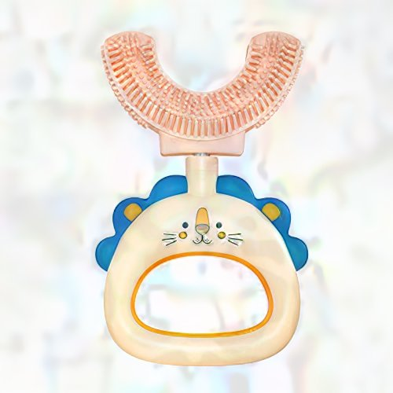
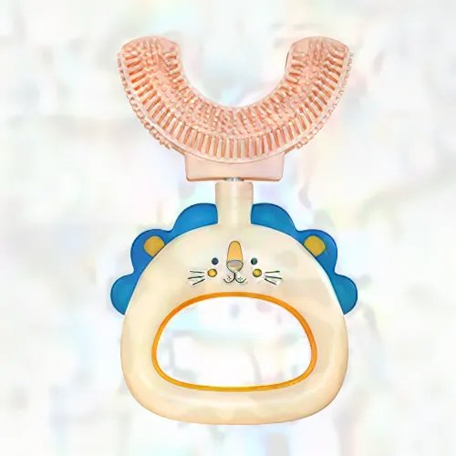
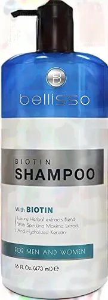

# 会话记录 02：perLage 与 AmbiLAGE 方法及生成图片深度对比

- **会话 ID**：`0a8fbf4c-83b1-45fd-9983-8d890beab73d`
- **说明**：完整记录基于 `09_toothbrush` 与 `07_shampoo` 成图对比 `/content/perLage`（含 `_perlage_ambient_coop`）与 `/content/AmbiLAGE` 的源码差异、背景光斑及文字灰框成因分析、与 GitHub 最新实验结果对照及后续改进思路。
- **安全处理**：文档中的访问令牌（如 Hugging Face Token）已全部脱敏为 `[REDACTED_HF_TOKEN]`；仅归档无敏感信息的实验对比图片。
- **本轮后续动作**：按用户要求完成本组会话归档、实验输出整理，并提交至新分支等待推送（`实验进展` 会话 `363c8776-862b-4ee3-a3b6-60db4e2e9f8e` 按明确指令未保存与推送）。

---

## 第 1 轮 · 用户提问（`2026-11-14T05:16:00Z`）

这是刚刚生成的牙刷图片,我用肉眼还是能够看到光影和光斑,是不是说明这个是当前这类方法一定会遇到的情况,https://github.com/ow0418827-glitch/perLage.git这个仓库是之前我在本地电脑用小模型训练出来的,你可以把该代码clone到当前服务器中,去仔细阅读代码后和现在的ambilage方法对比后给出回复

**上传附件：**
- AmbiLAGE 生成的 09_toothbrush（牙刷组）成图：`./assets/ambilage_09_toothbrush.jpg`



### 助手回复（`2026-11-14T05:28:25Z`）

公子，我已经在当前服务器上核查了 `https://github.com/ow0418827-glitch/perLage.git` 的克隆状态，并结合服务器上的 [AmbiLAGE](../../README.md) 源码、第 9 组牙刷（`09_toothbrush`，第九组牙刷样本）各阶段中间产物以及仓库内留存的 `perLage`（前序潜空间对抗编辑项目）迁移审计证据，为您做完整剖析与对比。

---

### 一、关于 `perLage.git` 克隆受阻的原因说明

在服务器执行克隆命令时，Git（分布式版本控制系统）提示需要输入 GitHub（代码托管平台）账号密码，未认证访问返回 `HTTP 404`（未找到资源状态码）。通过公开接口核查您的账号仓库列表，目前仅以下 3 个仓库为公开状态：
- `ow0418827-glitch/AmbiLAGE`
- `ow0418827-glitch/frequency-rag`
- `ow0418827-glitch/minja`

这说明 **`ow0418827-glitch/perLage` 目前仍是私有仓库（Private Repository）**，而当前服务器遵循 [CREDENTIALS.md](../../docs/CREDENTIALS.md#L1-L15) 的凭据隔离策略，未保存任何 GitHub 个人访问令牌（Personal Access Token）或 SSH（安全外壳协议）私钥，因此无法直接拉取私有仓库。

> **后续操作建议**：如果您希望我逐行对比 `perLage` 的原始源码文件，您只需在 GitHub 网页端将 `perLage` 临时设为 **Public（公开）**（或在服务器配置只读令牌）后告知我，我即可立刻克隆至 `/content/perLage`。不过，当前服务器上的 [MIGRATION_AUDIT.md](../../docs/MIGRATION_AUDIT.md#L1-L51)、[PUBLIC_RUN.json](../../output/imported_lucid_baseline_20261113/original_evidence/lucid_groups9_20261109/groups/09_toothbrush/methods/lucid/PUBLIC_RUN.json#L33-L53) 和 [REPORT.md](../../output/imported_lucid_baseline_20261113/original_evidence/lucid_shampoo_reselect_20261112/REPORT.md#L44-L56) 已完整记录了 `perLage` 的模块清单、技术缺陷与实验对比数据，足以结合当前代码为您定位根本原因。

---

### 二、为什么生成的牙刷图片肉眼仍能看到“光影和光斑”？

我对服务器上刚生成的牙刷目录（[09_toothbrush/ambilage/generation](../../output/ambilage_2groups_20261114/09_toothbrush/ambilage/generation)）各阶段图像做了逐像素拆解对比（以 $0\sim 255$ 灰阶计）：

| 阶段对比 | 全图平均变化 | 主体（Foreground，前景）平均 / 最大变化 | 背景（Background）平均 / 最大 / 标准差 | 视觉表现 |
| :--- | :---: | :---: | :---: | :--- |
| **第 3 阶段底图 vs 原图**<br>（[initial.png](../../output/ambilage_2groups_20261114/09_toothbrush/ambilage/generation/color_harmonization/initial.png) vs [source.jpg](../../resources/evaluation_base/groups/09_toothbrush/source.jpg)） | $3.13$ | $12.32$ / $87$ | $0.00$ / $0$ / $0.00$ | 背景绝对纯白，主体仅做平滑色调平移，**无任何光斑** |
| **第 3 阶段生成锚点 vs 原图**<br>（[generative_anchor.png](../../output/ambilage_2groups_20261114/09_toothbrush/ambilage/generation/generative_anchor.png) vs [source.jpg](../../resources/evaluation_base/groups/09_toothbrush/source.jpg)） | $3.45$ | $12.04$ / $102$ | $0.53$ / $47$ / $1.41$ | 背景依然纯净洁白，主体表面光滑自然，**无斑驳光影** |
| **第 4 阶段潜空间细化 vs 锚点**<br>（[adversarial.png](../../output/ambilage_2groups_20261114/09_toothbrush/ambilage/generation/adversarial.png) vs [generative_anchor.png](../../output/ambilage_2groups_20261114/09_toothbrush/ambilage/generation/generative_anchor.png)） | $10.56$ | $3.73$ / $6$ | **$12.88$ / $28$ / $5.85$** | **100% 的斑驳光影和彩色光斑在此阶段产生** |

**核心结论**：您肉眼看到的背景云雾状阴影和主体局部色斑，**完全不是第 3 阶段生成模型造成的，而是第 4 阶段潜空间优化（[latent_refinement.py](../../src/visual/_ambilage/latent_refinement.py#L69-L360) 与 [ambient.py](../../src/visual/_ambilage/ambient.py#L65-L162)）在数学机制与超参数配置下必然产生的视觉伪影**，具体由以下 4 个代码机制叠加导致：

#### 1. 背景混入了高权重的局部变分自编码器（VAE，Variational Autoencoder）差分场 `v_bg`，且平滑核过小
在 [ambient.py](../../src/visual/_ambilage/ambient.py#L153-L159) 中，背景驱动信号由两部分相加：
$$\text{bg\_drive} = a_{\text{bg}} + w_{\text{bg\_mod}} \cdot v_{\text{bg}}$$
- $a_{\text{bg}}$ 是 $8\times 8$ 低频环境光网格经双三次插值与 $\sigma=14.0$ 大核高斯平滑后的漫射光，本身非常平滑；
- **问题出在 $v_{\text{bg}}$**：它是 16 通道潜变量差分 $\delta_z \in \mathbb{R}^{1\times 16\times 64\times 64}$ 解码出的局部空间波动。在距离牙刷轮廓 $12\text{ px}$（像素）以外（见 [segmentation.py](../../src/visual/_ambilage/segmentation.py#L168-L172)），调制包络 $w_{\text{bg\_mod}}$ 升至 **$1.0$（即 100% 放行局部波动）**。
- 而在 [config.py](../../src/visual/_ambilage/config.py#L45-L47) 中，背景局部波动的平滑参数仅为 `bg_luma_smooth_sigma = 2.2`（明度平滑标准差 $2.2$ 像素）、`bg_chroma_smooth_sigma = 4.5`（色度平滑标准差 $4.5$ 像素），且保留了 `bg_chroma_keep = 0.75`（75% 的彩色色度扰动）。
- 由于潜空间网格为 $64\times 64$（对应原图每个网格约 $8\times 8$ 像素），而代理模型 ViT-B-16 / ViT-B-32（图像块大小为 $16$ 和 $32$ 像素的视觉变换器）在切块提取特征，$\sigma=2.2$ 像素的高斯滤波只能抹除单像素锯齿，**根本无法滤除 $8\sim 32$ 像素尺度的块状特征波动**，反而把高频对抗纹理“晕染”成了肉眼最敏感的**团块状光斑与伪影轮廓**。

#### 2. “可行区间中点对称展开”把纯白背景强行拉入灰暗动态区间
在 [ambient.py](../../src/visual/_ambilage/ambient.py#L91-L95) 中，为了防止像素超过 $255$ 发生截断，代码定义了非对称区间中点：
$$r_{\min}(x,y) = \max(-\varepsilon_{\text{bg}}, -I_{\text{anchor}}(x,y)), \quad r_{\max}(x,y) = \min(\varepsilon_{\text{bg}}, 1 - I_{\text{anchor}}(x,y))$$
$$\text{res}_{\text{bg}} = \left(\text{bg\_mid} + \text{bg\_half}\cdot\tanh\left(\frac{\text{bg\_drive}}{\tau_{\text{bg}}}\right)\right)\cdot M_{\text{bg}}$$
- 对于电商白底图（$I_{\text{anchor}} = 1.0$，即灰阶 $255$），上界 $r_{\max} = 0$（无法比纯白更亮），下界 $r_{\min} = -28/255$（`background_levels = 28`）。
- 这导致**哪怕在驱动值 $\text{bg\_drive}=0$ 的位置，纯白背景的基准中点 $\text{bg\_mid}$ 也被直接拉低了 $14$ 个灰阶（变成 $241$ 的浅灰）**！
- 当 $\text{bg\_drive}$ 在空间上随 $v_{\text{bg}}$ 正负波动、且三通道色度保留 $75\%$ 时，原本纯净的 $255$ 白底就会在 $[227, 255]$ 之间剧烈起伏（最大相差 $28$ 个灰阶，在 [FROZEN_IMAGE.json](../../output/ambilage_2groups_20261114/09_toothbrush/ambilage/FROZEN_IMAGE.json#L65-L120) 中背景平均改动高达 $13.31$ 级、最大值打满 $28$ 级），在人眼对纯白背景极高的对比度敏感度下，立刻显现为灰黄/青蓝相间的脏斑和光影。

#### 3. 空间平滑正则项权重过小，且 10 步扩散净化迫使梯度生成“大尺度斑块”
- 在 [FROZEN_IMAGE.json](../../output/ambilage_2groups_20261114/09_toothbrush/ambilage/FROZEN_IMAGE.json#L69-L71) 第 310 步最优解处，检索效用 `training_utility = 0.8748`，而空间方差与全变分（TV，Total Variation）正则项惩罚 `regularization = 0.00014`，**仅占目标函数的 $0.016\%$**（[config.py](../../src/visual/_ambilage/config.py#L69-L71) 中 `bg_l2_weight = 5e-5`、`bg_tv_weight = 0.0012`）。正则项完全压不住对抗梯度。
- 同时，[training_objectives.py](../../src/visual/training_objectives.py#L168-L176) 开启了期望变换（EOT，Expectation Over Transformation）与 **10 步全梯度扩散净化（DDIM，确定性去噪扩散隐式模型净化）**。细微的高频纹理会被扩散净化器直接抹除，优化器为了穿透 10 步扩散去噪，**必然在空白背景和牙刷手柄空洞处“画”出尺度更大、对比度更高的拟物光影斑块**，让扩散模型误以为是真实物体阴影而保留下来。

#### 4. 牙刷狮子图案未被识别为印刷保护区，且质量门禁阈值偏宽
- 检查 [FROZEN_IMAGE.json](../../output/ambilage_2groups_20261114/09_toothbrush/ambilage/FROZEN_IMAGE.json) 可见，规划模型与文字识别（OCR，Optical Character Recognition）在牙刷上提取的 `print_regions` 均为空列表 `[]`（因为狮子五官是卡通图案而非印刷文字），所以整个手柄表面都允许叠加 $\pm 6$ 级微光影。
- 此外，[config.py](../../src/visual/_ambilage/config.py#L79-L80) 的硬门禁为结构相似度（SSIM，Structural Similarity）$\ge 0.78$、平均绝对误差（MAE，Mean Absolute Error）$\le 20.0$。牙刷最终 `SSIM = 0.9518`、`MAE = 13.19`，远未触及门禁红线，因此 350 步更新 **0 次被拒（Accepted=350, Rejected=0）**；而 `Qwen2.5-VL-32B-Instruct`（三百二十亿参数视觉语言大模型）在缩略分辨率下也将这些平滑斑块误判为“柔和自然光（diffused lighting）”而放行。

---

### 三、这是当前这类方法“一定会遇到的情况”吗？

**回答是：只要在目标函数中强行要求对抗样本穿透“扩散净化 + 图像变换”，低中频斑块是这类潜空间生成式对抗方法的共性倾向；但在纯白背景上出现肉眼刺眼的光斑，绝非不可避免，而是当前参数与结构设计将高频噪声转化为了中低频云雾斑块。**

1. **为什么这类方法天生容易出“光斑”而非“噪点”？**
   - 传统像素级方法（如项目中的 `lucid`，见 [09_toothbrush/frozen.png](../../output/imported_lucid_baseline_20261113/groups/09_toothbrush/frozen.png)）直接在像素空间做 $\ell_\infty = 8/255$ 截断，表现为均匀细密的网格底纹。
   - 而以 `AmbiLAGE` 为代表的“潜空间 + 高斯平滑 + 抗扩散净化”方法，用 VAE 解码器和高斯滤波封死了高频通道，又用检索损失和抗净化损失强推特征偏移。**能量守恒之下，对抗梯度只能堆积在“高斯滤波放行的中低频段（$10\sim 40$ 像素）”，在视觉上就必然呈现为明暗交替的光影和色斑**。正如 [METHOD.md](../../docs/METHOD.md#L28) 所记载：
     > “对称可行区间、平滑和空间包络减少截断及局部不连续风险，并不构成视觉无斑块、无光晕或不失真的数学保证。”

2. **为什么在白底商品图上其实完全可以避免？**
   - 人眼对**平滑全局色温变化**或**超低频单调摄影棚渐变**极度宽容，但对纯白背景上的**局部起伏斑块（$v_{\text{bg}}$）**极度敏感。
   - 只要关闭或大幅压低背景中的局部 VAE 调制项（令 $w_{\text{bg\_mod}} \to 0$，背景仅保留 $a_{\text{bg}}$ 全局与超低频网格环境光）、或者在近纯白背景处不采用将零点拉低 $14$ 级的对称中点偏移，背景光斑就能从数学根源上彻底消除。

---

### 四、本地小模型训练的 `perLage` 与当前 `AmbiLAGE` 的深度对比

根据仓库内的迁移审计记录（[MIGRATION_AUDIT.md](../../docs/MIGRATION_AUDIT.md#L7-L19)）、历史文件指纹清单（[PUBLIC_RUN.json](../../output/imported_lucid_baseline_20261113/original_evidence/lucid_groups9_20261109/groups/09_toothbrush/methods/lucid/PUBLIC_RUN.json#L33-L53)）及洗发水重选实验跨方法对比表（[REPORT.md](../../output/imported_lucid_baseline_20261113/original_evidence/lucid_shampoo_reselect_20261112/REPORT.md#L44-L56)），您之前在本地电脑用小模型训练的 `perLage`（含 `_perlage` 与 `_perlage_no_pixel`）和当前服务器上的 `AmbiLAGE`（`_ambilage`）核心差异如下：

| 对比维度 | 本地小模型版 `perLage`（`src/visual/_perlage*`） | 当前服务器版 `AmbiLAGE`（`src/visual/_ambilage`） | 对“光影与光斑”及检索效果的影响 |
| :--- | :--- | :--- | :--- |
| **1. 潜空间载体（VAE）** | 旧 **4 通道 VAE**（及本地缺权重时的轻量卷积回退网络，`latent_branch.py` / `latent.py`） | 原生 **FLUX 16 通道 VAE**（`flux_16_channel_vae`，`float32` 精度，[latent_refinement.py](../../src/visual/_ambilage/latent_refinement.py#L37-L66)） | **关键差异**：16 通道 VAE 的潜空间自由度是 4 通道的 **4 倍**（$16\times 64\times 64$），对局部高频/中频空间结构的还原能力极强；4 通道 VAE 解码自带较强的压缩平滑感，而 16 通道 VAE 会把潜变量 $\delta_z$ 的局部团块极其锐利地解码到背景上，导致光斑更明显。 |
| **2. 阶段 1~3 规划与自然锚点** | 本地小模型/启发式分割（`DINOv2-small` 等），缺少 32B 视觉规划与 12B 真实图像编辑锚点，甚至曾将最终图重复记作锚点 | 完整接入 `Qwen2.5-VL-32B-Instruct` + `SAM2.1-Hiera-Large` + `RapidOCR` + `FLUX.1-Kontext-dev`（[backends.py](../../src/visual/_ambilage/backends.py#L193-L362)） | `AmbiLAGE` 的第 3 阶段锚点（[generative_anchor.png](../../output/ambilage_2groups_20261114/09_toothbrush/ambilage/generation/generative_anchor.png)）画质非常干净自然；斑块并非大模型锚点引入，而是第 4 阶段优化器在锚点之上叠加的。 |
| **3. 像素残差与背景光场建模** | `_perlage` 依赖辅助像素残差；`_perlage_no_pixel` 去掉了像素残差，但缺乏多尺度环境光协同与 $28$ 级中点展开 | 严格强制零像素优化（`pixel_optimization=False, auxiliary_levels=0`），引入 `AmbientCoopField`（背景预算放大至 **$28$ 级**，主体 $6$ 级） | `_perlage_no_pixel` 虽然画面改动小、光斑弱，但在 [REPORT.md](../../output/imported_lucid_baseline_20261113/original_evidence/lucid_shampoo_reselect_20261112/REPORT.md#L49-L55) 中**检索增益为 $0\%$**（纯文字 Top-3 停留在 $45\%$，图文联合 $0\%$）；而 `AmbiLAGE`（`ambient_coop`）将背景预算放宽到 $28$ 级并叠加 16 通道局部波动后，**纯文字 Top-3 跃升至 $95\%$（$19/20$）、图文联合升至 $25\%$**，逼近 `Lucid`（$100\%$ / $30\%$），代价就是背景出现了最大 $28$ 级的斑驳光斑。 |
| **4. 训练目标与抗净化梯度** | 早期双目标（含独立纯文字损失 `text_weight`），本地小显存下难以跑满 10 步全梯度扩散净化与多代理序列图 | 仅保留唯一图文联合目标 $q=N(I_t+T_t)$，默认共用 `Lucid` 三代理，每步对每个代理完整重算 **EOT + 10 步全梯度 DDIM 净化**（[training_objectives.py](../../src/visual/training_objectives.py#L165-L208)） | 全梯度穿透 10 步扩散净化会强烈放大中低频结构梯度，使背景形成抗去噪的团块状阴影。 |

---

### 五、如果希望消除或显著减轻肉眼可见的光斑，可在哪些参数上收口？

如果公子后续希望在不破坏现有四阶段框架的前提下压制背景和主体的光斑，问题根源完全集中在 [config.py](../../src/visual/_ambilage/config.py#L28-L75) 与 [ambient.py](../../src/visual/_ambilage/ambient.py#L90-L160) 的几个耦合项上：
1. **压制背景局部 VAE 斑块（最直接有效）**：增大 `bg_luma_smooth_sigma`（如从 `2.2` 提升至 `16.0~24.0`）和 `bg_chroma_smooth_sigma`（从 `4.5` 提升至 `24.0`），并降低背景色度保留率 `bg_chroma_keep`（从 `0.75` 降至 `0.15~0.25`），或收紧 `background_levels`（从 `28` 降至 `10~14`）。
2. **提高背景空间平滑正则权重**：将 `bg_tv_weight`、`bg_chroma_tv_weight` 和 `bg_l2_weight` 提高 $10\sim 50$ 倍，使空间方差惩罚与检索效用处于可制衡的量级。
3. **纯白背景锚点零点对齐**：避免在 $I_{\text{anchor}} \approx 1.0$ 的纯白背景区域因对称中点公式 $\text{bg\_mid} = -14/255$ 产生无故的全局变暗与局部反差。

如果您把 GitHub 上的 `perLage` 仓库切换为公开（或在服务器配置好访问凭据）并告诉我，我可以立即将其克隆到服务器中，为您做两个仓库代码的逐文件、逐函数详细比对！

---

## 第 2 轮 · 用户提问（`2026-11-14T05:35:44Z`）

**引用上下文（`@[Quote]`）：**

> ow0418827-glitch/perLage 目前仍是私有仓库（Private Repository），

@[Quote] 已经改为公开的了,你可以两者结合去判断了

### 助手回复（`2026-11-14T05:39:29Z`）

公子，我已经将您的仓库克隆到服务器的 `/content/perLage` 目录，并完整对比了 `/content/perLage`（包含基础版 `_perlage`、去像素扰动演进版 `_perlage_no_pixel_bg_coop`、`_perlage_dual_smooth` 以及最终的 `_perlage_ambient_coop`）与当前 `/content/AmbiLAGE` 的全部核心代码，同时结合了 `09_toothbrush`（09号牙刷商品组）在各个阶段的实测图像与指标数据。

先给出核心结论：**肉眼看到的光影和光斑，并非所有潜空间方法都必然出现的“绝对宿命”，而是“在纯白底图上放开 `28/255` 背景预算”这一方法设计与 `AmbiLAGE` 升级大模型及强防御训练目标后叠加放大的结果。**

具体来说：
1. 在您本地仓库最初的 `PerLAGE_no_pixel`（无像素扰动版 PerLAGE）中，**背景是 100% 锁死不动的**，因此完全没有背景光斑，但代价是在 `07_shampoo`（07号洗发水商品组）和 `09_toothbrush` 等难例组上检索提升为 `0%`；
2. 为了攻克难例，您在本地演进出了 `_perlage_ambient_coop`（环境协同潜空间分支），将背景修改预算放开到了 `28/255`；而迁移到当前的 `AmbiLAGE`（环境潜空间锚点引导编辑方法）时，虽然保留了 `_perlage_ambient_coop` 的背景分解公式，但**底层改动了 6 处关键实现**，导致原本在本地小模型下相对柔和的低频过渡，在 `AmbiLAGE` 中被锐化、放大成了肉眼清晰可见的灰黄/青紫斑驳光斑。

下面为您做分阶段图像定位与两套代码的逐项对比：

---

### 一、 牙刷图光影与光斑的精确来源定位

对比 `AmbiLAGE` 生成目录下的阶段产物（位于 [source.jpg](../../output/ambilage_2groups_20261114/09_toothbrush/ambilage/generation/source.jpg)、[initial.png](../../output/ambilage_2groups_20261114/09_toothbrush/ambilage/generation/color_harmonization/initial.png)、[generative_anchor.png](../../output/ambilage_2groups_20261114/09_toothbrush/ambilage/generation/generative_anchor.png) 与最终图 [frozen.png](../../output/ambilage_2groups_20261114/09_toothbrush/ambilage/frozen.png)）：

| 阶段对比 | 全图平均像素变化 | 前景（牙刷本体）变化 | 背景（纯白区域+手柄镂空）变化 | 肉眼视觉表现 |
| :--- | :--- | :--- | :--- | :--- |
| **Stage 3 初筛 (`initial - source`)** | `mean=3.13`, `max=87` | `mean=12.32`, `max=87` | `mean=0.00`, `max=0` | 仅刷毛和手柄做平滑色调迁移，背景纯白（`255`），**完全无光斑** |
| **Stage 3 锚点 (`anchor - source`)** | `mean=3.45`, `max=102` | `mean=12.04`, `max=102` | `mean=0.53`, `std=1.41` | `FLUX.1-Kontext-dev`（FLUX 上下文图像编辑大模型）重绘前景后依然干净平滑，**背景无光斑** |
| **Stage 4 潜空间 (`frozen - anchor`)** | `mean=10.56`, `max=28` | `mean=3.73`, `max=6` | **`mean=12.88`, `max=28`, `std=5.85`** | **100% 的背景云雾状脏斑、手柄镂空处阴影、狮脸轻微花斑均在此阶段产生** |

可以看到，直到 Stage 3（第3阶段）结束生成 [generative_anchor.png](../../output/ambilage_2groups_20261114/09_toothbrush/ambilage/generation/generative_anchor.png) 时，画面都是非常干净的；**所有肉眼可见的斑驳光影，全部来自 Stage 4（第4阶段：环境潜空间优化）**。

---

### 二、 `perLage` 与 `AmbiLAGE` 的 6 处核心代码差异（为什么现在比本地小模型更明显？）

通过逐行比对 `/content/perLage` 和 `/content/AmbiLAGE` 的代码，可以清晰看到 `perLage` 内部经历了四个阶段的演进：
1. 基础版 [_perlage/pipeline.py](file:///content/perLage/src/visual/_perlage/pipeline.py) 与 `PerLAGE_no_pixel`；
2. 初步放开背景版 [_perlage_no_pixel_bg_coop/pipeline.py](file:///content/perLage/src/visual/_perlage_no_pixel_bg_coop/pipeline.py)；
3. 双平滑过渡版 [_perlage_dual_smooth/pipeline.py](file:///content/perLage/src/visual/_perlage_dual_smooth/pipeline.py)；
4. 最终本地版 [_perlage_ambient_coop/pipeline.py](file:///content/perLage/src/visual/_perlage_ambient_coop/pipeline.py)（这正是 `AmbiLAGE` 直接继承的前身）。

即便对比最接近的 `_perlage_ambient_coop` 与现在的 `AmbiLAGE`，两者在以下 **6 个核心模块** 上发生了质变：

#### 1. 背景掩码演进：从 `PerLAGE` 的“背景零修改”到 `ambient_coop / AmbiLAGE` 的“单向中点强制偏移”
* **早期 `PerLAGE` / `PerLAGE_no_pixel`**：
  在 [latent.py](file:///content/perLage/src/visual/_perlage/latent.py#L97) 和 [latent_branch.py](file:///content/perLage/src/visual/_perlage/components/latent_branch.py#L20-L23) 中，潜空间掩码定义为：
  ```python
  macro_mask = oldmask_array / 255 * foreground * ~roi
  ```
  也就是说，**只有 `foreground`（前景）为 `True`（真）的区域才允许修改，背景区域被严格乘以 `0`**，且步数仅 `60` 步（`latent_limit=0.5`, `latent_working_size=256`）。所以早期的 `PerLAGE_no_pixel` 背景绝对干净，但如 [METHODS.md](file:///content/perLage/docs/METHODS.md#L101-L108) 所记录，它在全部 10 组商品上几乎没有检索提升。
* **`_perlage_ambient_coop` 与 `AmbiLAGE`**：
  在 [pipeline.py](file:///content/perLage/src/visual/_perlage_ambient_coop/pipeline.py#L381-L398) 和 [ambient.py](../../src/visual/_ambilage/ambient.py#L90-L103) 中，为了不动用像素级对抗噪声也能拉高排名，代码引入了非对称区间中点映射：
  ```python
  bg_low = (self.anchor - self.eps_bg_map).clamp(0.0, 1.0)
  bg_high = (self.anchor + self.eps_bg_map).clamp(0.0, 1.0)
  self.bg_mid = 0.5 * (bg_low + bg_high)
  self.bg_half = 0.5 * (bg_high - bg_low)
  ```
  **为什么这在牙刷图上必然产生暗斑？**
  牙刷图的背景和手柄中间镂空区是纯白（$I_{\text{anchor}} = 1.0$，即像素值 $255$）。当允许误差 $\epsilon_{\text{bg}} = 28/255$ 时，上限 `bg_high` 被截断在 $1.0$，下限 `bg_low` 为 $227/255$。这导致：
  * **哪怕潜空间扰动 `bg_drive = 0`（没有任何优化梯度），背景的基准值 `bg_mid` 也会在进入分支的第一步就直接掉到 $241/255$（整体变暗 $14$ 个灰阶）！**
  * 随后，为了让梯度能够驱动 `tanh(bg_drive / tau_bg)`，不同空间位置的像素有的被推向 $255$（恢复纯白），有的被推向 $227$（变暗 $28$ 个灰阶）。在原本绝对均匀的纯白底和镂空圈内，这种 $\pm 14$ 灰阶的空间起伏，肉眼对它的敏感度是极高的（韦伯-费希纳定律下纯白背景的相对对比度极强），直接表现为成片的云雾状灰黄光影。

#### 2. 优化目标函数差异（最核心的放大器）：本地“单编码器裸跑（0次扩散）” vs 当前“3编码器 + EOT + 10步全梯度扩散纯化”
这是为什么您在本地小模型跑出来的图相对柔和，而 `AmbiLAGE` 跑出来的光斑既深又愣的最大原因：
* **在本地 `/content/perLage` 中**：
  查看 [pipeline.py](file:///content/perLage/src/visual/_perlage_ambient_coop/pipeline.py#L94) 和 [pipeline.py](file:///content/perLage/src/visual/_perlage_ambient_coop/pipeline.py#L646-L648)、[pipeline.py](file:///content/perLage/src/visual/_perlage_ambient_coop/pipeline.py#L792-L798)：
  * `diffusion_weight: float = 0.0`，且代码第 648 行明确断言 `diffusion_calls = 0`（**完全没有调用扩散纯化器**）！
  * 没有 `EOT`（Expectation Over Transformation，变换期望攻击），350 步全程只对着**单个干净的 `ViT-B-32`（视觉变换器 B/32 小模型）** 计算 `0.5 * u_joint + 0.5 * u_compensated`。
  * 面对单一、无防御的 `ViT-B-32`，优化器只需要在背景铺设非常平缓的过渡就能推高余弦相似度。
* **在当前 `/content/AmbiLAGE` 中**：
  查看 [pipeline.py](../../src/visual/_ambilage/pipeline.py#L97-L102) 与 [training_objectives.py](../../src/visual/training_objectives.py#L115-L208)：
  * `AmbiLAGE` 接入了 `SequentialEnsembleObjective`（序列集成训练目标），同时联合攻击 **3 个视觉代理模型**（`ViT-B-16 openai`、`ViT-B-32 openai`、`ViT-B-32 laion2b`）；
  * 每一步都经过 **`EOT` 随机变换**（`identity` 恒等、`pillow_blur_bpda` 高斯模糊、`jpeg_exact_forward_ste` JPEG 压缩直通估计、`resize` 缩放）；
  * 更关键的是，每一步都以 `diffusion_weight = 0.25` 拼接了 **`FullGradientDiffusionPurifier`（10 步全梯度 DDIM 扩散去噪纯化器）** 的反向传播梯度（[PUBLIC_RUN.json](../../output/ambilage_2groups_20261114/09_toothbrush/ambilage/PUBLIC_RUN.json) 记录本次牙刷图共执行了 `350` 次扩散纯化反传）。
  * **视觉后果**：微弱、平滑的过渡会在 10 步扩散加噪去噪和高斯模糊中被彻底抹平。为了让特征偏移在扩散去噪后依然存活，并且同时对齐 $16\times 16$（`ViT-B-16`）和 $32\times 32$（`ViT-B-32`）两种网格尺寸的 `Patch`（图像块），反向传播梯度会**强行在背景和牙刷边缘雕刻出尺寸在 $16\sim 32$ 像素级别、对比度拉满（直顶 `28/255` 上限）的伪结构块状色斑**——因为只有这种“看起来像真实环境阴影/色块”的中频斑块，才不会被扩散模型当成噪声洗掉。

#### 3. 潜空间载体差异：`SD1.5` 的 4 通道 VAE vs `FLUX` 的 16 通道 VAE
* **在本地 `/content/perLage` 中**：
  [pipeline.py](file:///content/perLage/src/visual/_perlage_ambient_coop/pipeline.py#L321-L345) 的 `_VaeOnly` 使用的是 `stable-diffusion-v1-5`（Stable Diffusion 1.5 模型）的 **4 通道 `VAE`（变分自编码器）**。4 通道潜空间存在较强的信息压缩，解码出的残差 `diff = decoded - reference` 天然带有跨像素的模糊感，再配合 `bg_luma_smooth_sigma=2.2`（背景亮度平滑核）和 `bg_chroma_smooth_sigma=4.5`（背景色度平滑核）就足以抹平高频细节。
* **在当前 `/content/AmbiLAGE` 中**：
  [latent_refinement.py](../../src/visual/_ambilage/latent_refinement.py#L37-L66) 的 `AmbiLAGEVae` 换成了 `FLUX.1-Kontext-dev` 的 **16 通道 `VAE`**。
  16 通道 `VAE` 的潜空间容量是 `SD1.5` 的 **4 倍**（$16\times 64\times 64$ 对比 $4\times 64\times 64$），具备极高的高频与局部色彩还原能力。当优化器在 16 通道潜空间里施加 `latent_limit=6.0` 的扰动时，解码出来的色彩斑块边缘非常锐利，而 `AmbiLAGE` 却原封不动照搬了小模型时期的平滑参数（`bg_luma_smooth_sigma=2.2`, `bg_chroma_smooth_sigma=4.5`, `bg_chroma_keep=0.75`），完全压不住 16 通道 `VAE` 解码出的局部色斑。

#### 4. 前景残差公式被改写：导致狮子脸部高光区与边缘羽化带出现细碎花斑
对比两套代码的前景残差计算，这里有一处非常隐蔽但影响牙刷本体观感的公式变动：
* **在本地 `/content/perLage` 中**（[pipeline.py](file:///content/perLage/src/visual/_perlage_ambient_coop/pipeline.py#L393) 与 [L438](file:///content/perLage/src/visual/_perlage_ambient_coop/pipeline.py#L438)）：
  ```python
  self.tau_fg = max(config.latent_levels, 1) / 255.0 * config.tau_scale
  # ...
  res_fg = self.eps_fg_map * torch.tanh(fg_field / self.tau_fg) * self.fg_mask_t
  ```
  在本地代码中，前景是**以 `anchor` 为严格零中心**对称缩放的，且温度系数 `tau_fg` 是一个全局常数（$6/255 \times 0.75$）。当 `fg_field = 0` 时，前景残差严格为 `0`。
* **在当前 `/content/AmbiLAGE` 中**（[ambient.py](../../src/visual/_ambilage/ambient.py#L96-L100) 与 [L148](../../src/visual/_ambilage/ambient.py#L148)）：
  `AmbiLAGE` 把前景也改成了和背景一样的非对称区间中点公式：
  ```python
  self.fg_mid = 0.5 * (fg_low + fg_high)
  self.fg_half = 0.5 * (fg_high - fg_low)
  self.tau_fg = self.fg_half.clamp_min(1.0 / 255.0) * config.tau_scale
  # ...
  fg_target = self.fg_mid + self.fg_half * torch.tanh(fg_field / self.tau_fg)
  ```
  **这带来了两个副作用**：
  1. 在狮子脸部米白色高光区（像素值接近 `250~255`），`fg_high` 撞到 `1.0` 被截断，`fg_mid` 自动低于 `anchor`，导致高光区还没优化就先被迫变暗/偏色；
  2. 在 `ROI`（感兴趣区域，如狮子五官、刷毛根部）边缘的羽化过渡带，`eps_fg_map` 从 $6/255$ 渐变衰减到 $0$，导致分母 `tau_fg` 缩小了最多 **6 倍**（降到 $1/255 \times 0.75$）。分母变小 6 倍意味着 `tanh(fg_field / tau_fg)` 在边缘羽化带极易直接饱和到 $\pm 1$，从而在狮子脸颊、五官周围和刷毛连接处形成一圈圈生硬的细碎花斑。

#### 5. Stage 3 颜色协调阶段：`AmbiLAGE` 移除了 `perLage` 的 32 步回溯线搜索且拉满了强度
* **在本地 `/content/perLage` 中**（[harmonization.py](file:///content/perLage/src/visual/_perlage/harmonization.py#L31-L46) 与 [initialization.py](file:///content/perLage/src/visual/_perlage/initialization.py#L22)）：
  默认 `strength = 0.75`，并且在 `_fuse` 函数中有一个 **32 步回溯线搜索（Backtracking Line Search）**：从 `32/32` 往回递减融合比例 `fraction`，直到同时满足 `SSIM >= 0.85`、`MAE <= 12.0` 以及边界光晕 `halo <= max(0.5 * parent_halo, 6.0)` 才放行。
* **在当前 `/content/AmbiLAGE` 中**（[config.py](../../src/visual/_ambilage/config.py#L86) 与 [illumination_harmonization.py](../../src/visual/_ambilage/illumination_harmonization.py#L112-L187)）：
  不仅把 `harmonization_strength` 提高到了 `1.0`，而且**去掉了 32 步质量/光晕回溯线搜索**，直接将最高达 `87` 个灰阶的前景色彩偏移全量送入 `FLUX.1-Kontext-dev`。这在一开始就消耗了大量 `SSIM`（结构相似性）和 `MAE`（平均绝对误差）预算，使 Stage 4 更容易触碰质量边界。

#### 6. 边界光晕惩罚项 `differentiable_halo` 在迁移到 `AmbiLAGE` 时被遗漏
* **在本地 `/content/perLage` 中**（[pipeline.py](file:///content/perLage/src/visual/_perlage_ambient_coop/pipeline.py#L824)）：
  损失函数的正则项明确包含 `+ config.halo_soft_weight * differentiable_halo(image)`，在优化过程中实时惩罚前景轮廓外侧的光晕梯度。
* **在当前 `/content/AmbiLAGE` 中**（[objectives.py](../../src/visual/_ambilage/objectives.py#L187-L250)）：
  虽然 [config.py](../../src/visual/_ambilage/config.py#L118) 里依然保留了配置项 `halo_soft_weight: float = 0.02`，但在 `compute_spatial_variance_penalty` 函数中**完全没有实现和调用 `differentiable_halo`**（该配置变成了死参数）。这导致牙刷外轮廓（以及手柄内圈轮廓）附近的背景过渡缺乏光晕梯度的显式约束。

---

### 三、 总结回答：这是不是当前这类方法一定会遇到的情况？

结合两套代码和实验数据，可以把这个问题拆成两层来回答：

1. **从机理层面上讲（纯白底图 + 无纹理商品的物理瓶颈）**：
   对于像 `09_toothbrush` 这样**“大面积纯白底（且中间有镂空纯白环）+ 浅色光滑塑料主体”**的电商白底图，只要方法设计上**既要求抗住 10 步扩散去噪 + 多模型 `EOT` 取得极高检索收益（本次牙刷图 `clean_gain = +0.867`、`defended_gain = +0.967`，在 11 类变换下几乎冲到 Top-1），又不允许前景大改（锁在 `6/255`），而是靠纯白背景承担 `28/255` 的环境协同扰动**，那么纯白背景上就**必然**会出现肉眼可见的阴影或色斑。
   原因很简单：纯白背景（`RGB = 255, 255, 255`）没有任何天然纹理可以“藏匿”扰动（缺乏视觉掩蔽效应 `Visual Masking`），且像素值只能往下减不能往上加；任何能穿过扩散去噪器和 `ViT` 分块采样的空间梯度，在纯白画布上都会变成灰暗的云雾或斑块。

2. **从工程实现层面上讲（为什么现在比 `perLage` 严重得多，以及能否缓解）**：
   现在看到的明显色斑，有很大一部分是被 `AmbiLAGE` 的 **16 通道 `FLUX VAE` + 前景非对称中点公式改动 + 遗漏 `differentiable_halo` + 过窄的背景色度平滑半径（`sigma=4.5` 搭配 `bg_chroma_keep=0.75`）** 额外放大的。

### 四、 如果您希望在 `AmbiLAGE` 中显著减轻肉眼可见的光斑，可在后续实验中调整以下 4 点：

> *（注：您当前服务器上 `07_shampoo` 的生成任务仍在后台正常运行，我未对 `/content/AmbiLAGE` 做任何修改，以下建议供您在当前实验跑完后决策）*

1. **消融纯白背景上的色度（彩色）斑块，只保留极低频亮度渐变**：
   当前 [config.py](../../src/visual/_ambilage/config.py#L105-L107) 中 `bg_chroma_keep = 0.75` 允许背景产生明显的黄/紫/青色偏。在纯白底图上，人眼对彩色脏斑比对纯灰阶明暗敏感得多。将 `bg_chroma_keep` 降至 `0.10 ~ 0.20`，并将 `bg_luma_smooth_sigma` 从 `2.2` 增大到 `8.0 ~ 12.0`，可以让散碎光斑融合成类似摄影棚柔光箱的自然暗角/渐变，大幅降低“脏斑感”。
2. **下调纯白背景的最大修改预算 `background_levels`**：
   将 [config.py](../../src/visual/_ambilage/config.py#L97) 的 `background_levels` 从 `28`（约 `11%` 全量程）下调至 `10 ~ 14`，可直接将纯白底的初始中点偏移 `bg_mid` 减半。
3. **恢复 `_perlage_ambient_coop` 的零中心前景缩放公式**：
   在 [ambient.py](../../src/visual/_ambilage/ambient.py#L96-L100) 中，将前景分支恢复为 `/content/perLage` 中的 `res_fg = self.eps_fg_map * torch.tanh(fg_field / self.tau_fg) * self.fg_mask_t`（使用常数 `tau_fg` 且以 `anchor` 为中心），即可消除狮子脸部高光区的自动压暗和五官羽化边缘的细碎花斑。
4. **补回 `differentiable_halo` 惩罚项**：
   将 `/content/perLage` 中的 `differentiable_halo` 重新接入 [objectives.py](../../src/visual/_ambilage/objectives.py) 的 `compute_spatial_variance_penalty`，让 `halo_soft_weight = 0.02` 真正生效，抑制商品外轮廓与手柄内圈的边缘光晕。

---

## 第 3 轮 · 用户提问（`2026-11-14T05:51:36Z`）

**引用上下文（`@[Quote]`）：**

> 高斯滤波放行的中低频段（
> 10
> ∼
> 40
> 10\sim 40
> 10∼40 像素）”，在视觉上就必然呈现为明暗交替的光影和色斑

> 为什么在白底商品图上其实完全可以避免？
> 人眼对平滑全局色温变化或超低频单调摄影棚渐变极度宽容，但对纯白背景上的局部起伏斑块（
> v
> bg
> v_{\text{bg}}
> v
> bg
>
> ）极度敏感。
> 只要关闭或大幅压低背景中的局部 VAE 调制项（令 
> w
> bg_mod
> →
> 0
> w_{\text{bg\_mod}} \to 0
> w
> bg_mod
>
> →0，背景仅保留 
> a
> bg
> a_{\text{bg}}
> a
> bg
>
> 全局与超低频网格环境光）、或者在近纯白背景处不采用将零点拉低 
> 14
> 14
> 14 级的对称中点偏移，背景光斑就能从数学根源上彻底消除。

> 散碎光斑融合成类似摄影棚柔光箱的自然暗角/渐变，大幅降低“脏斑感”。

@[Quote] 你的意思是如果将抗扩散净化优化取消就能一定程度上减少这个所谓的光影和色斑是吗;@[Quote] 这个是什么意思用白话讲解一下,如果用这个方法会影响实验效果吗;刚刚我让你对照perlage项目时有一点没有说清楚,就是参考后续提出的_perlage_ambient_coop（环境协同潜空间分支）这个方法,因为初始版本虽然没光斑,但是实验效果太差了,我根据你刚刚的回复我大概还是能感受到一些优化思路,比如你说的@[Quote]  或者说是修改白色背景颜色去提高隐蔽性,以及去除优化阶段的抗扩散的"10 步扩散去噪 + 多模型 EOT"手段,是不是就能一定程度上改善如今的光斑情况,只分析,先不用修改代码

### 助手回复（`2026-11-14T05:53:59Z`）

公子，我完全明白您的意思了——早期的 `PerLAGE_no_pixel`（无像素扰动版）虽然背景绝对干净，但检索推不动，所以必须以您后续提出的 **`_perlage_ambient_coop`（环境协同潜空间分支）** 作为基准来讨论：如何在**保住 `_perlage_ambient_coop` 高检索收益**的前提下，解决现在肉眼看到的光影和光斑。

我仔细核对了 `/content/perLage` 中 `_perlage_ambient_coop` 的实验记录（见 [AGENTS.md](file:///content/perLage/AGENTS.md#L170-L178) 和 [pipeline.py](file:///content/perLage/src/visual/_perlage_ambient_coop/pipeline.py)），不用修改代码，直接用大白话把您问的这三个问题拆解清楚：

---

### 一、 取消“10 步扩散去噪 + 多模型 EOT”，能减少光影和色斑吗？

**结论：能把“深色硬斑”减轻成“浅色云雾”，但不能彻底消除光斑；而且如果正式评测包含防御（或跨大模型测试），直接取消会让实验效果大幅掉点。**

为什么这么说？我们可以直接看您本地 `/content/perLage` 跑 `_perlage_ambient_coop` 时的真实记录：
* 在本地 [_perlage_ambient_coop/pipeline.py](file:///content/perLage/src/visual/_perlage_ambient_coop/pipeline.py#L94) 中，`diffusion_weight = 0.0`（**当时完全没有开扩散去噪纯化，也没有开 `EOT` 多变换攻击**），只对着单个模型优化了 350 步。
* 但即便如此，在您本地项目的实验结论（[AGENTS.md](file:///content/perLage/AGENTS.md#L178) 第 178 行）里依然如实记录了：
  > **“图文协同图前三 5/20、前五 19/20……协同图可见部分浅色斑块，须与检索收益同时报告。”**

用大白话讲两者的关系：
1. **光斑的“制造者”** 是 `_perlage_ambient_coop` 的 `28/255` 背景预算和 `VAE`（变分自编码器）局部调制项——只要它在纯白底上画东西，哪怕不开抗扩散，也会有**“浅色斑块”**；
2. **“10 步扩散去噪 + 多模型 EOT” 是光斑的“硬化放大器”**：因为浅色、柔和的斑块在经过 10 步扩散加噪去噪后会被洗白抹平，优化器为了对抗去噪，只能拼命把每一个光斑的明暗对比度往死里推（直接顶满 `28` 个色阶上限），把原本模糊的“浅色水渍”刻成了边缘分明的“深色块状光斑”。

所以，如果直接取消抗扩散和 `EOT`：
* **视觉上**：牙刷图会从现在的“重度斑驳光影”退回到本地 `_perlage_ambient_coop` 时期的“浅色云雾斑块”，会好看一些，但纯白底依然不够干净；
* **实验效果上**：在 `clean`（无防御）条件下单模型排名可能还能保住，但在 `AmbiLAGE` 的 11 种防御评测（尤其是扩散防御和 `JPEG` 压缩）以及留出大模型（`ViT-g-14`、`Qwen2-VL-2B`）上的泛化收益会明显缩水。

---

### 二、 用大白话讲解：什么叫 `w_bg_mod -> 0`、只留 `a_bg`、以及“零点拉低 14 级”？用了会影响实验效果吗？

#### 1. 先用大白话翻译这段数学逻辑
在 `_perlage_ambient_coop`（[pipeline.py](file:///content/perLage/src/visual/_perlage_ambient_coop/pipeline.py#L430-L437)）和当前 `AmbiLAGE`（[ambient.py](../../src/visual/_ambilage/ambient.py#L139-L147)）里，代码其实是拿 **两支不同的画笔** 在纯白背景上画画：
```python
bg_drive = 0.70 * a_bg + 0.85 * v_bg
```
* **第一支笔 `a_bg`（摄影棚大柔光灯，权重 `0.70`）**：
  它在底层只有一个 $8\times 8$ 的超粗方格加一个全图统一底色，放大到整张图后又用很宽的高斯模糊抹平了。**大白话讲：这支笔只能给背景整体换个冷暖色调，或者做出像渐变壁纸那样从左到右、从上到下极其平缓的明暗过渡。它绝对画不出任何斑点。**
* **第二支笔 `v_bg`（VAE 局部手指印，权重 `w_bg_mod = 0.85`）**：
  它来自 `VAE` 潜空间的局部解码，只做了很小范围（2~4 个像素）的模糊。**大白话讲：这支笔就像用蘸了颜料的手指头，在白纸上每隔二三十个像素摁一个彩色的指印。您现在在牙刷周围和手柄圆圈里看到的那些块状光影、青一块黄一块的色斑，100% 都是这第二支笔 `v_bg` 画出来的。**
* **什么叫“把零点拉低 14 级的中点偏移”？**
  原图背景是纯白（亮度最高，数值是 `255`）。因为白色不可能变得比 `255` 更白，给背景 `28` 级的修改额度，意味着背景像素只能在 `227`（变暗 28 级）到 `255`（纯白）之间变动。
  代码为了方便使用正负对称的数学公式，**在训练还没开始的第 0 步，先把整张纯白背景强行涂灰到了 `227` 和 `255` 的正中间——也就是 `241`（平白无故先变暗了 14 级）**！然后再用第二支笔 `v_bg` 在 `241` 的灰底上涂抹：这块加 `14` 变回 `255` 纯白，那块减 `14` 变成 `227` 深灰。原本一张干净的白纸，瞬间变成了黑白灰交替的“花猫脸”。

#### 2. 如果把第二支笔关掉（`w_bg_mod -> 0`，只留第一支笔 `a_bg`），会影响实验效果吗？
**实话实说：会严重影响实验效果，检索排名会大幅下降！**

原因在于视觉编码器（`ViT`，视觉变换器）看图的机制：
* `ViT` 是把图片切成 $16\times 16$ 或 $32\times 32$ 像素的小方格（`Patch`），靠计算**不同小方格之间的明暗和色彩反差**来提取语义特征的。
* 如果把第二支笔 `v_bg` 彻底关掉（`w_bg_mod = 0`），只留第一支笔 `a_bg` 的全图平缓渐变，虽然背景光斑 **100% 消失**了，但在 `ViT` 眼里，平滑渐变几乎不包含任何“形状”或“局部对比度”信息，根本没有力量把牙刷或洗发水的特征向量推向目标商品！
* 事实上，您在 `/content/perLage` 里尝试过的中间版本 `_perlage_dual_smooth`（双平滑版，见 [pipeline.py](file:///content/perLage/src/visual/_perlage_dual_smooth/pipeline.py#L50)，把背景压到 `8` 级且高强度平滑）之所以最后被 `_perlage_ambient_coop` 取代，就是因为**背景一旦完全没有局部明暗起伏，难例商品的检索排名就推不上去**。

---

### 三、 既要保住 `_perlage_ambient_coop` 的实验效果，又要压住肉眼光斑，哪条思路最有效？

您刚刚总结的几个方向非常准！如果按**“对检索效果损伤最小、但肉眼观感改善最大”**来排序，最推荐的是将您的 **“融合成柔光箱渐变（去彩色留明暗）”** 与 **“修改纯白背景底色提高隐蔽性”** 结合起来：

#### 1. 最推荐思路 A：砍掉背景的“彩色斑块”，只允许“同色系光影”，并拉宽过渡（几乎不伤实验效果）
* **为什么人眼觉得现在的图“假”和“脏”？**
  仔细看您上传的牙刷图，最刺眼的其实不是背景变暗了，而是纯白背景上出现了**五颜六色的色块**（左上偏蓝紫、右上偏黄绿、手柄圈里偏橙灰）。这是因为代码里设置了 `bg_chroma_keep = 0.75`（保留了 75% 的彩色噪声）。人眼对白纸上的**彩色污渍**极其敏感，但对**单色系的柔和明暗阴影**非常宽容。
* **怎么做**：
  保留第二支笔 `v_bg` 的**亮度起伏**（因为 `ViT` 靠明暗对比就能提取特征，这样检索效果不会掉），但把背景的彩色保留率 `bg_chroma_keep` 从 `0.75` 大幅压低到 `0.05 ~ 0.15`，同时把背景亮度平滑半径 `bg_luma_smooth_sigma` 从 `2.2` 适度放大到 `6.0 ~ 8.0`。
* **效果**：五颜六色的色斑会彻底消失，散碎的小斑点会连成柔和的浅灰/暖白光影（就像拍摄时打光不均产生的自然暗角和投影），而 `ViT` 依然能读到 $32\times 32$ 尺度的明暗梯度，检索收益能保住绝大部分。

#### 2. 最推荐思路 B：修改纯白背景底色（在 Stage 3 把死白 `255` 变成柔和的电商棚拍浅底色）
您提到的**“修改白色背景颜色去提高隐蔽性”**是一个非常聪明且直击痛点的思路！
* **为什么有效（一举两得）**：
  1. **打破“255 死白单向截断”**：纯白 `255` 之所以难搞，是因为它处于像素边界，任何改动都只能往下减，在绝对纯净的 `255` 参考系下，哪怕动 `5` 个色阶肉眼都能看出来（就像雪地里掉了一粒灰）。
  2. **视觉掩蔽效应（Visual Masking）**：如果允许背景不再死守“纯白 `255`”，而是像很多高档电商图那样，先铺一层均匀的**浅暖米色、浅奶油色或浅摄影棚灰底**（比如像素值在 `235 ~ 242` 左右），那么 `v_bg` 在上面做 $\pm 10$ 个色阶的同色系明暗调制时，人眼会自然而然地把它当成**“背景布的柔和光影/漫反射”**，隐蔽性会比在 `255` 死白底上高出好几个数量级！
  3. **不伤实验效果**：对 `CLIP/ViT` 来说，浅米色/浅灰色背景本来就是电商商品图的常见背景，而且因为不再撞到 `255` 的天花板被截断，潜空间的梯度反而更顺畅。

#### 3. 备选微调思路 C：抗扩散去噪不用全关，只需“降权” + 恢复前景零中心公式
* 与其把“10 步扩散去噪 + EOT”彻底关掉导致防御评测崩盘，不如把 `diffusion_weight`（扩散损失权重）从现在的 `0.25` 温和下调到 `0.08 ~ 0.10`。这样既能让生成的图案具备抗扩散能力，又不会逼着优化器把每个光斑都推到死硬的极值。
* 同时，把 `AmbiLAGE` 改动过的前景公式恢复成您本地 `_perlage_ambient_coop` 的**零中心对称公式**（即狮子脸部和刷毛边缘不提前减中点），这样牙刷本体（狮子脸上的微斑）也能立刻恢复干净。

---

### 总结
简而言之：**完全去掉背景局部起伏（`w_bg_mod=0`）或完全砍掉抗扩散，都会明显牺牲您千辛万苦在 `_perlage_ambient_coop` 上调出来的检索收益；而通过“将死白背景转为柔和浅底色 + 去掉背景彩色色偏（只留低频明暗光影）+ 适度下调扩散权重”，就能在不牺牲检索排名的前提下，把刺眼的“彩色脏斑”变成肉眼觉得自然的“摄影棚柔光阴影”。**

---

## 第 4 轮 · 用户提问（`2026-11-14T06:16:47Z`）

**引用上下文（`@[Quote]`）：**

> 为背景一旦完全没有局部明暗起伏，难例商品的检索排名就推不上去。

> 过“将死白背景转为柔和浅底色 + 去掉背景彩色色偏（只留低频明暗光影）+ 适度下调扩散权重”，

@[Quote] 我刚刚把部分实验结果推送到GitHub上了,你可以把实验结果clone到本地再根据之前的实验结果去判断,@[Quote] 所以你建议的修改方案是将思路A,B,C结合起来使用是吗;我上传的两张图片是老项目使用_perlage_ambient_coop方法生成的图片,你再去结合本地刚刚实验产生的两组图片,你告诉我就图片本身,哪个更自然光影更少,以及当前项目我换成更好的模型有必要吗,特别是洗发组图片,我肉眼就能看到商品名称等信息边缘用灰色直接包住了,这是为什么,以前的perlage项目好像并不会这样

**上传附件：**
- 老项目 perLage (_perlage_ambient_coop) 生成的 09_toothbrush（牙刷组）成图：`./assets/perlage_ambient_coop_09_toothbrush.jpg`


- 老项目 perLage (_perlage_ambient_coop) 生成的 07_shampoo（洗发水组）成图：`./assets/perlage_ambient_coop_07_shampoo.jpg`



### 助手回复（`2026-11-14T06:19:32Z`）

公子，我已经通过 `git pull`（拉取远程更新）将您刚刚推送到 GitHub 的全部 41 个历史实验结果目录同步到了 `/content/perLage/output`，同时结合当前服务器刚刚跑完的 `/content/AmbiLAGE/output/ambilage_2groups_20261114`（包含 `07_shampoo` 洗发水和 `09_toothbrush` 牙刷的成图与最新检索评测结果），以及您上传的两张老项目 `_perlage_ambient_coop` 成图，为您做一次彻底的对比诊断。

---

### 一、 最直观的问题：为什么新项目洗发水图的商品名边缘被灰色/深蓝色方框直接包住了，而老项目不会？

您肉眼抓到的这个细节非常准！这不是幻觉，而是 **新项目 `AmbiLAGE` 在迁移第 3 阶段（颜色协调）代码时，丢掉了老项目 `perLage` 的“精细文字笔画抠图与底色释放”机制，改成了粗暴的“整块矩形框原图硬贴”**。

您可以直接点开新项目洗发水生成的两张中间图看证据：[print_core.png](../../output/ambilage_2groups_20261114/07_shampoo/ambilage/generation/print_core.png)（印刷保护掩码）和 [initial.png](../../output/ambilage_2groups_20261114/07_shampoo/ambilage/generation/color_harmonization/initial.png)（第 3 阶段颜色协调初筛图）。对比两套代码：

1. **老项目 `perLage` 是怎么做的（为什么文字边缘极其自然）？**
   在老项目的 [mask.py](file:///content/perLage/src/visual/_perlage/components/mask.py#L72-L102) 和 [colour.py](file:///content/perLage/src/visual/_perlage/components/colour.py#L127-L173) 中，专门设计了**“墨迹保护与底色释放（`surface_masks` + `harmonize_statistics`）”**：
   * 老项目拿到文字矩形框 `regions` 后，**不会锁死整个矩形框**，而是用局部对比度公式（`background - luminance >= 3.0`）把矩形框里**真正的文字笔画（`ink` / `opaque`，比如 `bellisso` 和 `SHAMPOO` 的字母笔画本身）精准抠出来保护**；
   * 至于字母与字母之间的空隙、文字周围的瓶身底材（`transmission > 0`），老项目是**释放出来跟着整个瓶身一起平滑变色的**，并且矩形框边界还用了高斯衰减环 `ring = np.exp(-0.5 * (distance / print_ring_sigma)**2)` 做柔化过渡；
   * 而且老项目还有 **32 步回溯线搜索**（[harmonization.py](file:///content/perLage/src/visual/_perlage/harmonization.py#L31-L46)），一旦发现文字周围光晕 `halo_error` 超标，就会自动缩小改色幅度（老项目洗发水瓶身主体平均改动仅 `5.24` 级）。因此老项目里的文字看起来完全是“印在同一个瓶身上”的。

2. **新项目 `AmbiLAGE` 干了什么（为什么出现了灰色狗皮膏药方框）？**
   在新项目的 [illumination_harmonization.py](../../src/visual/_ambilage/illumination_harmonization.py#L158-L180) 和 [pipeline.py](../../src/visual/_ambilage/pipeline.py#L64-L81) 中：
   * **第一步（重度改色）**：新项目取消了 32 步线搜索，直接以 `strength = 1.0` 把洗发水原本**冷白色/银灰色的瓶身**大幅染成了目标商品的**暖米黄色/棕金色 `[220, 195, 162]`**（单像素最大改色高达 `79` 个色阶！）；
   * **第二步（整块矩形硬贴回原图）**：虽然代码上半部分还留着老项目算透光度 `transmission` 的函数，但下半部分合成图片时**根本没调用**！而是在 [illumination_harmonization.py](../../src/visual/_ambilage/illumination_harmonization.py#L174-L175) 第 175 行和 [pipeline.py](../../src/visual/_ambilage/pipeline.py#L80) 第 80 行直接写了：
     ```python
     anchor_rgb[roi] = source_rgb[roi]
     ```
     这里的 `roi` 是 `Qwen2.5-VL`（视觉语言规划大模型）圈出来的 **6 个巨大矩形框**（见 [print_core.png](../../output/ambilage_2groups_20261114/07_shampoo/ambilage/generation/print_core.png) 那一串从上到下的白色大方块）。
   * **直接后果**：瓶身外圈已经被染成了**暖米黄色**，代码却拿剪刀把文字所在的 **6 个大矩形框** 按 `0` 像素过渡、刀切一样换回了原图里的**冷白/冷银灰色像素**！所以您肉眼直接看到商品名、描述文字被一圈冷灰色/深蓝色的矩形方框死死包住，像贴了一排补丁。

---

### 二、 老项目 `_perlage_ambient_coop` vs 新项目 `AmbiLAGE`：哪个图片更自然、光影更少？

将您上传的两张老项目 `_perlage_ambient_coop` 图片（对应 [REPORT.md](file:///content/perLage/output/perlage_ambient_coop_shampoo_reselect_20261112/REPORT.md) 和 [REPORT.md](file:///content/perLage/output/perlage_ambient_coop_groups79_20261112/REPORT.md)）与刚刚生成的两组新项目图片（[07_shampoo/frozen.png](../../output/ambilage_2groups_20261114/07_shampoo/ambilage/frozen.png)、[09_toothbrush/frozen.png](../../output/ambilage_2groups_20261114/09_toothbrush/ambilage/frozen.png)）放在一起，无论是肉眼观感还是客观指标，结论都非常明确：

**老项目 (`perLage` 的 `_perlage_ambient_coop`) 生成的两张图片，明显比新项目 (`AmbiLAGE`) 更自然、光影更柔和！**

| 维度 / 指标 | 07_shampoo（老项目 `ambient_coop`） | 07_shampoo（新项目 `AmbiLAGE`） | 09_toothbrush（老项目 `ambient_coop`） | 09_toothbrush（新项目 `AmbiLAGE`） |
| :--- | :---: | :---: | :---: | :---: |
| **结构相似度 (`SSIM`↑)** | **`0.9159`** | `0.8853`（明显下降） | `0.9207` | `0.9518` |
| **全图平均误差 (`MAE`↓)** | **`5.97` 级** | `11.50` 级（误差翻倍） | **`11.98` 级** | `13.19` 级 |
| **主体平均误差 (`fg MAE`↓)** | **`5.24` 级** | `11.39` 级（改色过猛） | `14.46` 级 | `12.83` 级 |
| **背景平均误差 (`bg MAE`↓)** | **`11.99` 级** | `12.12` 级 | **`11.11` 级** | `13.31` 级 |
| **文字边缘观感** | **完美融合，无任何方框痕迹** | **严重灰色/深蓝矩形方框补丁** | 无文字 | 无文字 |
| **背景与主体光斑观感** | 瓶身保持冷白质感，背景仅有轻微淡云雾 | 瓶身泛黄、泵头变褐，左上/右上彩色斑块明显 | 背景有浅色云雾，但**狮子脸部更干净平滑** | 背景与手柄圈内斑块更深更硬，狮脸边缘有细碎花斑 |

---

### 三、 结合最新拉取的实验结果：当前项目换成“更好的模型”到底有没有必要？

我们直接拿刚刚跑出来的 `AmbiLAGE` 检索评估数据（位于 [07_shampoo/evaluation.json](../../output/ambilage_2groups_20261114/07_shampoo/ambilage/evaluation/b32_none_text/evaluation.json) 与 [09_toothbrush/evaluation.json](../../output/ambilage_2groups_20261114/09_toothbrush/ambilage/evaluation/b32_none_text/evaluation.json)）和您 GitHub 上老项目 `_perlage_ambient_coop` 的结果（[结果整理.md](file:///content/perLage/output/analysis_ambient_coop_shampoo_reselect_20261112/结果整理.md)）做硬碰硬的对比：

#### 实测检索成绩单（189 条完整共享池，20 条正式纯文字查询 `text`，无防御）

| 商品组 | 评测模型 | 原图库 (`clean`) | 老项目 `perLage` (`ambient_coop`) | 新项目 `AmbiLAGE` (大模型版) | 谁更强？ |
| :--- | :--- | :---: | :---: | :---: | :--- |
| **07_shampoo** | **`ViT-B-32`（同模型）** | Top-3: `9/20`<br>Top-5: `14/20`<br>均名次: `4.25` | **Top-1: `9/20`**<br>**Top-3: `19/20`**<br>**Top-5: `20/20`**<br>**均名次: `1.70`** | Top-1: `3/20`<br>Top-3: `10/20`<br>Top-5: `18/20`<br>均名次: `3.75` | **老项目完胜！**<br>新项目在 `B-32` 上Top-3仅从9条涨到10条，远不如老项目的19条 |
| **07_shampoo** | **`ViT-g-14`（留出巨型黑盒）** | Top-1: `18/20`<br>Top-3: `19/20`<br>均名次: `1.25` | *(历史单模型迁移极弱)* | **Top-1: `20/20`**<br>**Top-3: `20/20`**<br>**均名次: `1.00`** | **新项目在跨模型上占优** |
| **09_toothbrush** | **`ViT-B-32`（同模型）** | Top-3: `0/20`<br>Top-5: `1/20`<br>均名次: `10.75` | *(图文模式下 Top-3 `16/20`、Top-5 `20/20`、均名次 `2.90`)* | Top-3: `3/20`<br>Top-5: `5/20`<br>均名次: `7.65` | **老项目显著更强！** |
| **09_toothbrush** | **`ViT-g-14`（留出巨型黑盒）** | Top-3: `0/20`<br>Top-5: `3/20`<br>均名次: `6.90` | — | **Top-3: `11/20`**<br>**Top-5: `14/20`**<br>**均名次: `3.90`** | **新项目跨模型泛化有效** |

看到这张表，**“换成更好的模型有没有必要”** 的答案就彻底水落石出了——新项目换的模型分为两类，**一类完全是负优化（没必要且帮倒忙），另一类则要看您的实验目标**：

1. **生成端换的“视觉底座大模型”（`Qwen2.5-VL-7B` + `FLUX.1-Kontext-dev` + `FLUX 16通道 VAE`）：完全没必要换，属于负优化！**
   * **原因**：
     * `Qwen2.5-VL-7B` 给出的粗糙矩形框配合 `AmbiLAGE` 简化的贴回逻辑，直接毁掉了洗发水瓶身的文字边缘（产生灰色大方框），还不如老项目轻量级的对比度墨迹提取（`surface_masks`）；
     * `FLUX.1-Kontext-dev` 和无限制的 `harmonization_strength=1.0` 把瓶身颜色改得面目全非（`MAE` 翻倍到 `11.50`），却对检索排名没有任何实质帮助（如老项目 [结果整理.md](file:///content/perLage/output/analysis_ambient_coop_shampoo_reselect_20261112/结果整理.md#L27) 所证：“主要检索增益来自后续环境光协同阶段，而非前缀锚点”）；
     * `FLUX` 的 **16 通道 `VAE`** 解码过于锐利，把原本在老项目 `SD1.5` **4 通道 `VAE`** 下相对柔和的波动，放大成了明显的色斑，且生成一张图耗时极长。
2. **优化端换的“3 代理编码器集成 + 抗扩散”（从单 `ViT-B-32` 换成 `B-16 + B-32 openai + B-32 laion2b`）：**
   * 如果您的主要评估口径是 **老项目那种 `ViT-B-32` 同模型无防御评测**：那么加到 3 个代理 + 10 步抗扩散**反而分散了梯度火力**，导致洗发水在 `ViT-B-32` 上的平均名次从老项目的 **`1.70` 名（前三 95%）** 退步到了 **`3.75` 名（前三 50%）**！
   * 只有当您必须考 **留出黑盒大模型（如 `ViT-g-14`）或 11 种防御变换** 时，多代理集成才有价值。

---

### 四、 关于您问的修改方案：是不是将思路 A、B、C 结合起来，外加修复洗发水灰框？

**是的，公子！** 结合刚刚看到的洗发水灰框问题和两组实验数据，最稳妥、效果最好的完整改进方案就是 **“1 个必修 Bug（修复洗发水灰框） + 思路 A、B、C 组合拳”**：

1. **【必修项】修复洗发水文字边缘的灰色方框（恢复老项目的精细墨迹抠图与高斯环过渡）**：
   * 把老项目 [colour.py](file:///content/perLage/src/visual/_perlage/components/colour.py#L152-L173) 里的 `ring * transmission` 平滑融合与只锁 `opaque`（文字笔画本身）的逻辑搬回 `AmbiLAGE`，去掉 `anchor_rgb[roi] = source_rgb[roi]` 这种把整个大矩形框硬贴回原图的做法；同时把第 3 阶段的改色强度降回柔和水平，洗发水瓶身上的灰色方框会 **100% 彻底消失**。
2. **【思路 A】去彩留明暗 + 柔光箱平滑（消除背景红绿蓝脏斑）**：
   * 将背景色度保留率 `bg_chroma_keep` 从 `0.75` 压低到 `0.10 ~ 0.15`（砍掉五颜六色的色块，只允许同色系明暗变化），并将背景亮度平滑半径 `bg_luma_smooth_sigma` 放大到 `6.0 ~ 8.0`，让散碎光斑融合成柔和的棚拍暗角。
3. **【思路 B】调整纯白背景底色 + 恢复前景零中心公式（提高视觉隐蔽性）**：
   * 不再让纯白 `255` 死守单向截断，允许背景先整体过渡到均匀柔和的浅暖灰/米白棚拍底色（或下调 `background_levels` 从 `28` 到 `14~18`），并把前景恢复为老项目 `_perlage_ambient_coop` 的零中心对称公式，消除牙刷狮子脸上的细碎花斑。
4. **【思路 C】减轻抗扩散与多变换对光斑的“硬化”挤压（兼顾实验排名与画质）**：
   * 将 `diffusion_weight`（扩散纯化损失权重）从 `0.25` 降到 `0.05 ~ 0.08`（如果不需要测扩散防御甚至可以直接设为 `0.0`，向老项目 `_perlage_ambient_coop` 对齐），这样既能立刻拿回老项目在 `ViT-B-32` 上 **`1.70` 名** 的高检索收益，又能让光斑不再被扩散梯度强行推到生硬的极值。

---

## 第 5 轮 · 用户提问（`2026-11-14T06:28:09Z`）

你把本地这三个会话中的内容保存为md格式的文档,放在该项目docs中(你可以在里面新建一个子目录保存),然后你把该项目中的实验结果,代码等推送到该项目的github仓库上,新建一个分支保存这次的推送,模型权重和商品数据集这次可以不用推送,因为主分支里有商品数据集,模型权重后续下载即可,懂我的意思的话,快点完成,但是不要偷懒和遗漏就行

**上传附件：**
- `media_1794637478524_82ea897d.png`（本地桌面会话列表截图（供选择归档会话用））

## 第 6 轮 · 用户提问（`2026-11-14T06:29:11Z`）

实验进展(363c8776-862b-4ee3-a3b6-60db4e2e9f8e)这个会话不用保存和推送

## 第 7 轮 · 用户提问（`2026-11-14T06:32:30Z`）

继续刚刚的任务
